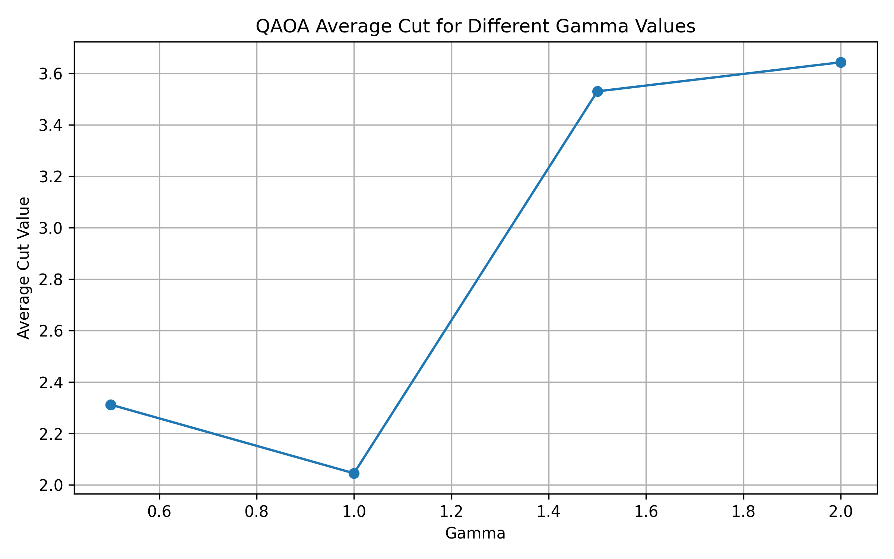

# Quantum Max-Cut: A Comparative Study of QAOA and Classical Optimization

## Problem Statement
Max-Cut is a graph optimization problem that divides vertices into two groups to maximize the number of edges connecting different groups.

## Objective
Explore the Max-Cut problem and compare a classical optimization baseline with the Quantum Approximate Optimization Algorithm (QAOA).

## Technologies
- Python
- Qiskit
- Qiskit Aer
- SciPy
- NetworkX
- Matplotlib
- Google Colab

## Classical Baseline
The example graph contains 5 vertices and 7 edges.

The classical exhaustive-search baseline found a best cut value of 5.

## Quantum Approach

We constructed a parameterized QAOA circuit using Qiskit. The circuit uses Hadamard gates to initialize a superposition, RZZ gates to encode the Max-Cut cost interactions, and RX gates for the mixer operation.

We evaluated the circuit using Qiskit Aer with 1,024 measurement shots per parameter setting. Four combinations of gamma and beta were tested, and the measured bitstrings were evaluated using the Max-Cut objective.

The best observed QAOA sample reached a cut value of 5, matching the classical optimum for this graph.
## How to Run

1. Open `main.ipynb` in Google Colab.
2. Run the dependency installation cell at the beginning of the notebook.
3. Execute the remaining cells in order.
4. Review the classical baseline, QAOA measurements, parameter sweep, and result plots.

Dependencies are listed in `requirements.txt`.

## Limitations
The current classical experiment uses a small graph. Simulation results alone do not demonstrate quantum advantage.
## Experimental Results

We tested QAOA on a graph containing 5 vertices and 7 edges.

### Classical Baseline
- Best cut value found by exhaustive search: 5

### QAOA Parameter Sweep

We tested four parameter settings using Qiskit Aer with 1,024 measurement shots per setting.

| Gamma | Beta | Average Cut Value | Best Observed Cut |
|---:|---:|---:|---:|
| 0.5 | 0.25 | 2.312 | 5 |
| 1.0 | 0.50 | 2.045 | 5 |
| 1.5 | 0.75 | 3.530 | 5 |
| 2.0 | 1.00 | 3.643 | 5 |

The highest average cut value among these tested settings was 3.643 at Gamma = 2.0 and Beta = 1.0. The best observed QAOA sample reached the classical optimum of 5.

These results are from a small simulation experiment and do not establish a quantum advantage.

### Parameter Sweep Plot

### Results Data

The numerical results are available in `qaoa_parameter_results.csv`.
